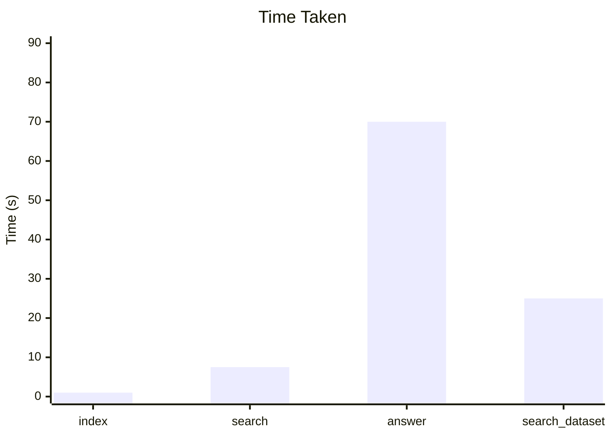
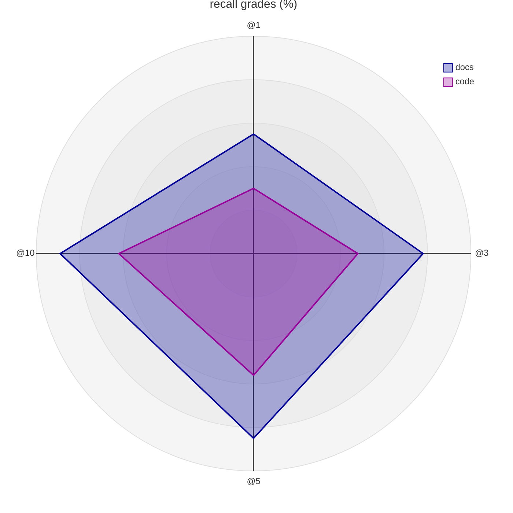

*This project has been created as part of the 42 curriculum by bgix.*


# <span style="font-size: 60px;">RAG</span> <br> <p style="text-align: right; font-size: 30px;">Against the machine</p> 


# Description

RAG is a project where we have to understand and implement a chunking strategy and a retriever.

After indexing, they must rate a question given by the user and return "k" sources with a score rating its relatability.

With that we must implement a LLM that can anwser the questions, and specify if it can not with its given sources.

Results of a datasets needs to be stored in either output/search_results or output/search_results_and_answer


# Instructions

There is a grand total of 6 possible commands.

```bash
uv run python3 -m src index -max_chunk_size <int>
```

Ask the program to index into chunks all files or director in data/raw into chunks of maximum "int" size.

The program will not work if no index is found, if a file is already present where it saves, it will be replaced.

**This command must be ran first for other command to work properly.**


```bash
uv run python3 -m src search <question> -k <int>
```

This command search through all the chunks and give best k sources found by the retriever

```bash
uv run python3 -m src search_dataset -dataset_path <path> -k <int> -save_directory <dir>
```

This command work the same as the one above, but this time, it will seek through a dataset json file, and write in the selected directory a new json file with all k best sources.

```bash
uv run python3 -m src answer <question> -k <int>
```

This is much like the search command, this time, however, it will call the LLM to give directly the answer using the k best sources, if the sources provide enough informations.

```bash
uv run python3 -m src answer_dataset -student_search_results_path <path> -save_directory <dir>
```

This command will take a file generated by the "search_dataset" command and use the LLM to anwser each questions within the dataset.

```bash
uv run python3 -m src evaluate -student_search_results_path <path> -dataset_path <path>
```

This command will compare the student dataset result with the one given and deduce if the sources given are correct.

it will check the first 1, 3, 5 and 10 sources in a set and give the overall percent of success.
(this command do not and must not use the given moulinette by the subject)


# Resources

Peers:
    Overall understanding of the subject


AI:
    Help with the understanding for BM25

[BM25s Sources]([https://bm25s.github.io)

# System Architecture


# Chunking Strategy

The file is given to langchain, and with it a priority set depending on the format (.py for exemple).

it will value to cut at the start of a fuction or start of a title instead of cutting after x Characters

```mermaid
architecture-beta
    group rag(mdi:network-attached-storage)[Chunking]
    service files(mdi:database)[Files] in rag
    service lang(mdi:database-search)[LangChain] in rag
    service prio(mdi:priority-high)[Format] in rag
    service cut(mdi:box-cutter)[splice by priority] in rag
    service json(mdi:code-json)[save as json in index] in rag

    files:R --> L:lang
    prio:T --> B:lang
    lang:R --> L:cut
    cut:R --> L:json
```



# Retrieval Method

BM25s simply put, will take a query/question and a source of index, it will process every chunk to see how much a chunk is related to the question and when finished.

Then it will return the k ammount of sources with the highest score.


# Performance Analysis

Here is two graph related to my performance.

for the time taken, i did not add anwser_dataset but it take around 30 min for 100 questions.






# Design Decisions

There was not much designs decisions as its mostly read and write.

tqdm was used for visual loading bar in the terminal.

# Challenge Faced

The biggest and only problem i really had was the setup for correct answer by the llm,

and making sure i had at least 5% more for all type than required as a safety net


# Exemple Usages

a RAG can be implemented in many tough documentation, it allows user to search for any data they have.

It can also be used for AI, since we can not give all documentation to an AI, we can use a RAG to chunk the sources and give it to AI.